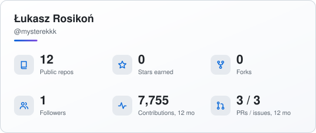
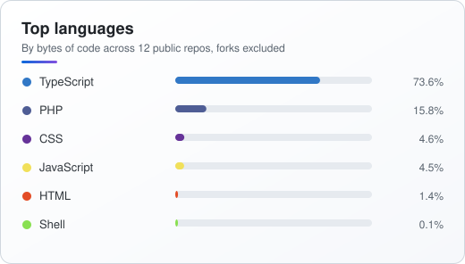
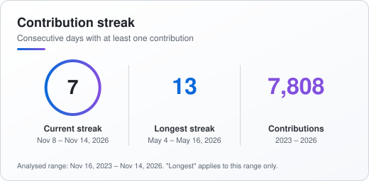
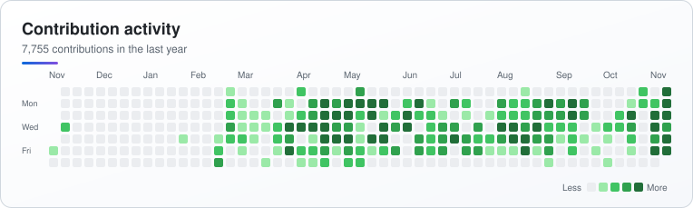
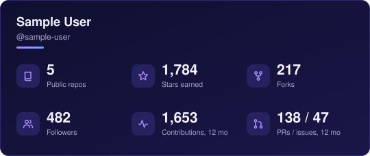
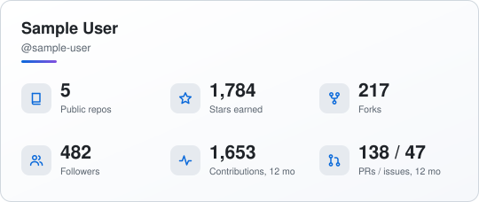
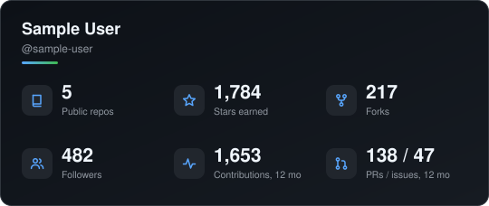
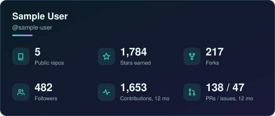
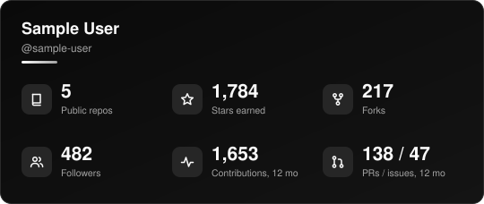
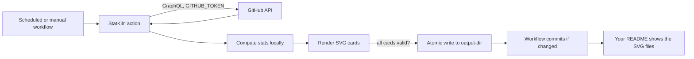

<div align="center">


**GitHub stats. Built, not hosted.**

A GitHub Action that bakes static SVG stat cards into your own repository.<br>
No image server, no hosting, no personal access token.

[](https://github.com/mysterekkk/statkiln/actions/workflows/ci.yml)
[](LICENSE)
[](https://github.com/mysterekkk/statkiln/releases)
[](action.yml)

</div>

## Preview

Generated by StatKiln itself from the public data of this repository's owner (refreshed daily by the [demo workflow](.github/workflows/demo.yml)). Light/dark switching uses `<picture>`.

<p align="center">
  <picture>
    <source media="(prefers-color-scheme: dark)" srcset="assets/demo/overview-dark.svg">
    
  </picture>
  <picture>
    <source media="(prefers-color-scheme: dark)" srcset="assets/demo/languages-dark.svg">
    
  </picture>
</p>
<p align="center">
  <picture>
    <source media="(prefers-color-scheme: dark)" srcset="assets/demo/streak-dark.svg">
    
  </picture>
</p>
<p align="center">
  <picture>
    <source media="(prefers-color-scheme: dark)" srcset="assets/demo/contributions-dark.svg">
    
  </picture>
</p>

## Why StatKiln?

- **No external image server.** The cards are plain `.svg` files committed to your repo. Opening your profile never calls a third-party service.
- **Your SVGs live in your repository.** Version history included; if a refresh fails, the last good cards stay in place.
- **Automated daily updates.** One scheduled workflow, commits only when something actually changed.
- **Customizable themes.** Five built-in themes, light/dark pairs, and a handful of options.
- **No personal access token** for basic public stats. The automatic `GITHUB_TOKEN` is enough.
- **Open source, tiny, and auditable.** Zero production dependencies; the committed `dist/index.js` is built deterministically and checked in CI.

## Quick start

**1. Create a workflow** in the repository that should hold the cards (for a profile, the repo named after your username): `.github/workflows/statkiln.yml`

```yaml
name: StatKiln

on:
  workflow_dispatch:
  schedule:
    - cron: '23 3 * * *'

permissions:
  contents: write

concurrency:
  group: statkiln
  cancel-in-progress: false

jobs:
  cards:
    runs-on: ubuntu-latest
    timeout-minutes: 10
    steps:
      - uses: actions/checkout@v7

      - uses: mysterekkk/statkiln@v1
        with:
          theme-light: light
          theme-dark: midnight

      - name: Commit changes
        run: |
          git config user.name "github-actions[bot]"
          git config user.email "41898282+github-actions[bot]@users.noreply.github.com"
          git add assets/statkiln
          if git diff --cached --quiet; then
            echo "No changes."
          else
            git commit -m "chore: update StatKiln cards"
            git push
          fi
```

**2. Run it once** from the *Actions* tab (*StatKiln → Run workflow*).

**3. Embed the cards** in your README:

```html
<picture>
  <source media="(prefers-color-scheme: dark)" srcset="assets/statkiln/overview-dark.svg">
  
</picture>
```

Prefer a single theme? Drop `theme-light`/`theme-dark`, set `theme: midnight`, and use ``. More snippets: [`examples/`](examples).

> If your default branch is protected, allow `github-actions[bot]` to push, or run the job against a branch that is not protected.

## Themes

Previews below use **sample data** (a made-up `sample-user`), not real statistics.

| Theme | Look | Preview |
| --- | --- | --- |
| `midnight` (default) | Elegant dark navy with violet accents |  |
| `light` | Clean, professional light theme |  |
| `github-dark` | Close to the GitHub dark palette |  |
| `aurora` | Subtle teal and violet gradients |  |
| `minimal` | Near-monochrome and quiet |  |

```yaml
- uses: mysterekkk/statkiln@v1
  with:
    theme: aurora            # one theme, files named overview.svg, ...
    # or a light/dark pair, files named overview-light.svg / overview-dark.svg:
    # theme-light: light
    # theme-dark: github-dark
```

## Configuration

| Input | Default | Description |
| --- | --- | --- |
| `username` | repository owner | GitHub user to build cards for |
| `github-token` | `${{ github.token }}` | Token for reading public data. The automatic token is enough |
| `theme` | `midnight` | `midnight`, `light`, `github-dark`, `aurora`, `minimal` |
| `theme-light` / `theme-dark` | – | Set both to write `<card>-light.svg` and `<card>-dark.svg` instead |
| `output-dir` | `assets/statkiln` | Output directory, relative to the repo root (path traversal is rejected) |
| `cards` | `overview,languages,streak,contributions` | Comma-separated subset |
| `language-count` | `6` | Languages shown, 1–12 (the rest is grouped as "Other") |
| `exclude-forks` | `true` | Ignore forks in repo, star, fork and language numbers |
| `show-border` | `true` | Draw a card border |
| `show-icons` | `true` | Icons in the overview card |
| `timezone` | `UTC` | IANA zone that defines "today" for streaks, e.g. `Europe/Warsaw` |
| `history-years` | `3` | Years of history analysed for streaks, 1–10 |

Outputs: `files` (comma-separated paths) and `changed` (`true`/`false`).

### What each number means

| Number | Definition |
| --- | --- |
| Public repos / stars / forks | Public repositories you own (forks excluded by default). Stars and forks are summed over those repos. |
| Followers | Current follower count. |
| Contributions, 12 mo | GitHub's contribution calendar total for the last 365 days (commits, PRs, issues, reviews, as GitHub counts them). **Not** the number of commits. |
| PRs / issues, 12 mo | Pull requests and issues you opened in the last 365 days. |
| Current streak | Consecutive days with at least one contribution, ending today, or yesterday if today has none yet. |
| Longest streak | Longest streak **within the analysed range** (`history-years`, capped by account age). Not an all-time record. |
| Languages | Share of bytes of code per language across your public repos, as detected by GitHub's linguist. See limitations. |

## How it works



All cards are rendered in memory first. Only if every card is valid are files written (temp file + rename), and unchanged files are not touched. If the API fails, the job fails and your previous cards remain exactly as they were. Details: [docs/architecture.md](docs/architecture.md).

## Limitations

- Stats are **not** live: they update when the workflow runs, not when someone views your profile.
- The GitHub API has rate limits and can be unavailable. StatKiln retries with backoff and respects `Retry-After`, then fails without touching existing files.
- Scheduled workflows can be delayed, and GitHub disables scheduled workflows in public repositories after 60 days without repository activity. If the cards stop updating, check the *Actions* tab and re-enable the workflow.
- Only public data is read. Private repositories and private contributions are not included (private contributions appear in GitHub's calendar only if you enabled that setting in your profile).
- Language shares are based on bytes of code detected by linguist: vendored files are excluded, but generated or very large files can still skew results, and bytes are not a measure of skill or effort.
- Contribution timestamps follow GitHub's calendar, which may differ slightly from your local time zone.
- `GITHUB_TOKEN` in a workflow can read public data of any user, but repositories you can only see through organizations are out of scope.

## Development

```bash
npm ci
npm run lint
npm run typecheck
npm test
npm run build      # writes dist/index.js (commit it)
```

Generate cards locally, using `GITHUB_TOKEN`/`GH_TOKEN` or your existing `gh auth login` session:

```bash
# Bash
npm run generate -- --username octocat --theme midnight --out-dir demo/generated
```

```powershell
# PowerShell
npm run generate -- --username octocat --theme midnight --out-dir demo/generated
# optional explicit token (never commit it):
$env:GITHUB_TOKEN = "<token>"
```

`npm run gallery` regenerates the sample-data theme previews. See `npm run generate -- --help` for all flags.

## Contributing

Issues and pull requests are welcome. Please read [CONTRIBUTING.md](CONTRIBUTING.md) first. Security issues: see [SECURITY.md](SECURITY.md).

## License

[MIT](LICENSE)

## Support

Questions and bugs: [GitHub Issues](https://github.com/mysterekkk/statkiln/issues). Ideas: [Discussions](https://github.com/mysterekkk/statkiln/discussions).

---

<p align="center">If StatKiln saved you a hosting bill, a ⭐ is appreciated.</p>
